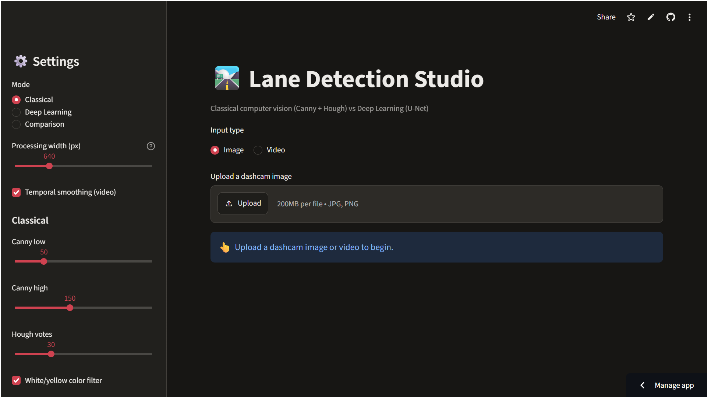
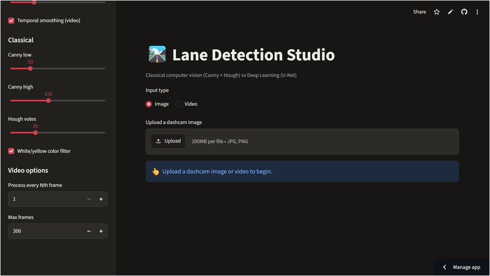
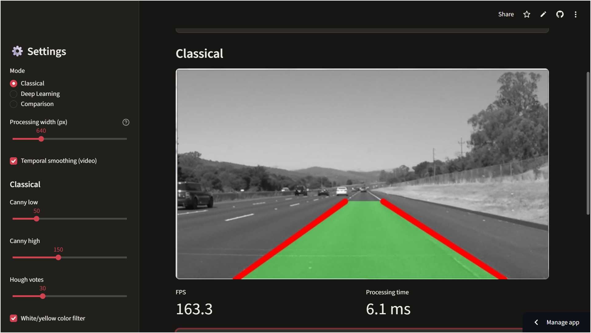
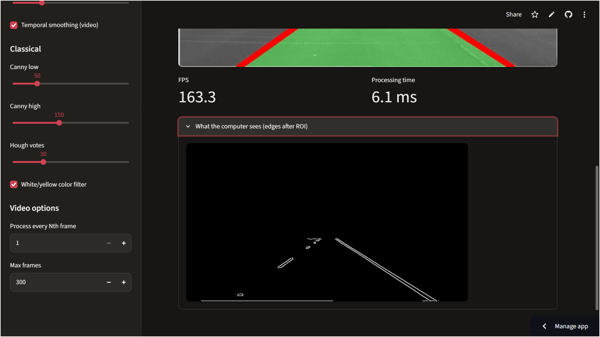
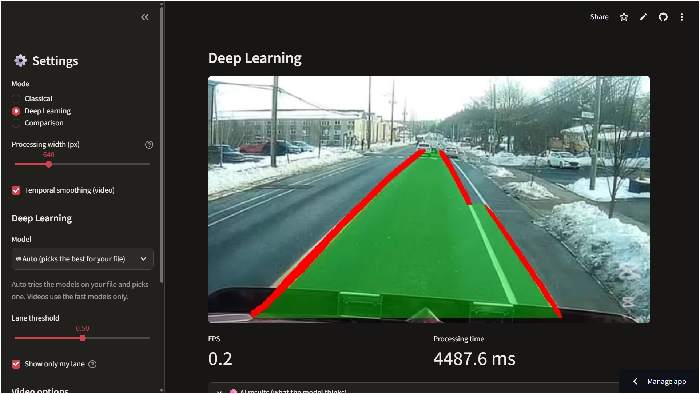
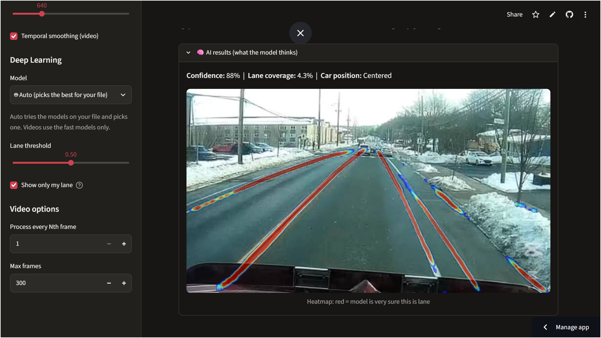
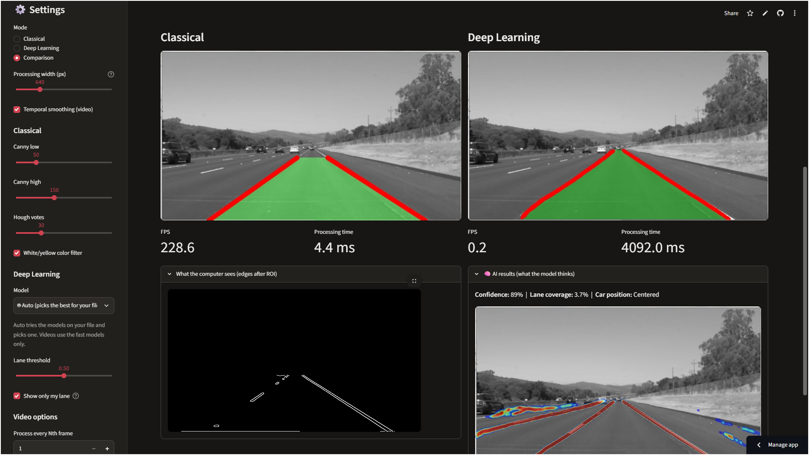
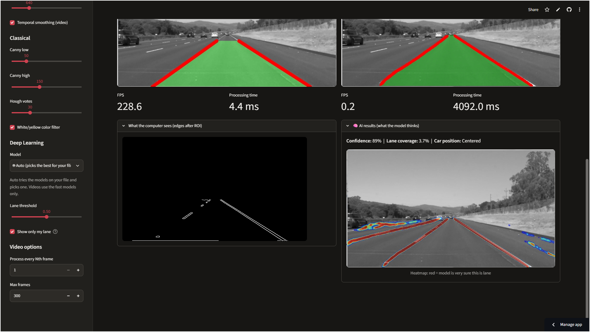
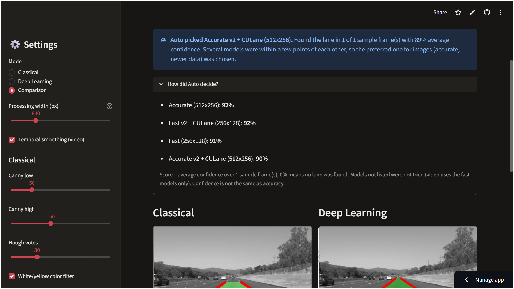

# 🛣️ Autonomous-Vehicle-Lane-Detection
Detect road lanes from dashcam footage using computer vision.

📸 Screenshots

| Main UI |
|:-------------------:|
|  |
|  |

| Classical Detection |
|:-------------------:|
|  | 
|  | 

| Deep Learning Detection |
|:-----------------------:|
|  |
|  |

| Comparison Mode |
|:-----------------------:|
|  |
|  |

| Deep Learning Models Confidence Score |
|:-------------------------------------:|
|  |

🌐 Live demo
👉 **[Try the Live Demo here](https://autonomous-vehicle-lane-detection-9a7cuj4bmnmkumrb7vjmzs.streamlit.app///)**

✨ Overview

Lane Detection Studio finds the lane a car is driving in, draws it on the picture, and tells you how well it is doing. It contains two complete detectors behind one interface, so you can swap them, benchmark them and compare them in the same app:

                
                Classical pipeline	                                Deep-learning pipeline
_______________________________________________________________________________________________________________________________
Idea	          Hand-written rules: edges, colour, geometry	        A U-Net learns what a lane looks like from labelled photos
Speed (CPU)	    ~145 FPS	                                          ~30 FPS (fast model) · ~5 FPS (accurate model)
Strength	      Extremely fast, needs no training	                  Handles faded paint, snow, dim light and curves far better
Weakness	      Fails on faded paint, snow, low light	              Needs training data and more compute

Features

- 🧠 Classical detector: grayscale + blur → Canny edges + white/yellow colour mask → trapezoid region of interest → probabilistic Hough transform → slope-based left/right split → length-weighted averaging → temporal smoothing. Includes a geometry sanity check that rejects crossed or widening lane pairs instead of drawing a wrong shape.

- 🤖 U-Net detector (PyTorch): trained on real TuSimple labels plus a balanced CULane subset. Two sizes: fast (256×128) and accurate (512×256). The checkpoint stores its own input size, so inference needs no config changes.

- 🚗 "Show only my lane" filter: keeps the lane the car is in and hides neighbouring lanes and stray blobs by tracking the two lane lines upward from the bottom of the image.

- 📊 AI results panel: model confidence, lane coverage, estimated car position (centred / left / right of the lane) and a probability heat-map showing what the model "sees".

- 🖥️ Streamlit app: upload an image or video; run Classical, Deep Learning or Comparison; live FPS and processing time; side-by-side view; downloadable result video; switchable model weights.

- 🔌 ROS-style architecture (pure Python, no ROS install needed): publish/subscribe message bus with camera, lane and display nodes, queue size 1 with drop-oldest, and dropped-frame accounting.

- 🤖 Auto model selection: tries the models on your file and picks one. Videos use only the fast models for speed; close calls go to the model trained on more varied data.

- ⏱️ Benchmark script, 72 automated tests, modular package layout.

🔥 Key Features

  - Dual pipeline (Classical + Deep Learning)
  - Real-time / near real-time video processing
  - Interactive **Streamlit** web application
  - Side-by-side comparison mode
  - Multiple pre-trained U-Net weights (Fast & Accurate versions)
  - Temporal smoothing for stable video results
  - Confidence score, lane coverage & car position insights
  - Probability heatmap visualization
  - Downloadable result videos
  - Clean modular code structure
  - ROS-style interface support

🛠️ Tech Stack

  | Category              | Tools |
  |-----------------------|-------|
  | Classical CV          | OpenCV, NumPy |
  | Deep Learning         | PyTorch, U-Net |
  | Web App               | Streamlit |
  | Video Processing      | OpenCV |
  | Testing               | Pytest |
  | Optional              | ROS-style interface |

🚀 Quick start

   1. Install
       bash
       git clone https://github.com/YOUR-USERNAME/lane-detection.git
       cd lane-detection

       python -m venv .venv
       # Windows:      .venv\Scripts\activate
       # macOS/Linux:  source .venv/bin/activate

       pip install -r requirements.txt

   Tested with Python 3.12 on Windows (CPU only). Developer tools (pytest) are in requirements-dev.txt.

   2. Run the app 
       bash
       streamlit run app/app.py

   Open the printed local URL, choose Image or Video, upload a dashcam file and pick a mode.

   3. Or use the command line
       bash
       python -m run_lane --help          # process an image or video from the terminal
       python -m benchmark --video path/to/your_dashcam.mp4
       python -m ros_demo --video path/to/your_dashcam.mp4 --weights weights/unet_lane_fast_v2.pt --no-show

         Bring your own dashcam clip (.mp4). Videos and datasets are not stored in this repository.

📈 Results

  Measured on a Lenovo ThinkPad T14 laptop, CPU only, 640 px wide frames, mean of 60 frames after 3 warm-up frames (python -m benchmark):

  Model	                      Input size	         Trained on	                                         Mean time	 FPS	      Validation IoU¹
 ____________________________________________________________________________________________________________________________________________
  Classical (Canny + Hough)	   n/a	                n/a	                                               6.9 ms	     145.0	      n/a
  U-Net fast v2 (default)	     256×128	            TuSimple + CULane subset (9,626 frames)	           30.0 ms	   33.3	        0.446
  U-Net fast	                 256×128	            TuSimple (3,626 frames)	                           32.7 ms	   30.6	        0.586
  U-Net accurate v2	           512×256	            TuSimple + CULane subset (9,626 frames)	           191.9 ms	    5.2	        0.470
  U-Net accurate	             512×256	            TuSimple (3,626 frames)	                           198.6 ms	    5.0	        0.609

  ¹ IoU is measured on a held-out validation split of each model's own training data, so rows with different training sets are not directly comparable. The "v2" models   score lower because their validation set also contains harder CULane frames (city streets, night, shadows). Run-to-run timing varies by roughly ±20% on a laptop.

  Takeaways

   - The fast U-Net is about 6× faster than the accurate one and runs at roughly camera speed (~30 FPS) on a laptop CPU, for a small IoU difference.
 
   - The "show only my lane" filter adds about 5 ms per frame.

   - In qualitative checks on dashcam frames outside the training data (snowy road, dim forest road), both the original and the CULane-trained models found the correct lane, while classical detection often found only one line. The v2 models did not show a visible improvement on those easy scenes; a quantitative comparison on unseen CULane frames is on the roadmap.
   
   - The Streamlit app shows lower FPS than the benchmark because the browser and two detectors share the same CPU.

🧩 How it works
                                                   
   - Both detectors expose the same method, .process(frame, smooth) -> DetectionResult, which is why the app, the benchmark and the ROS-style demo can use either one.

   - Classical pipeline
     > Grayscale and blur remove colour and noise.
     > Canny finds sharp edges; an HLS colour mask keeps white and yellow paint.
     > A trapezoid region of interest keeps only the road in front of the car.
     > Probabilistic Hough transform turns edge pixels into line segments.
     > Segments are split into left (leaning \) and right (leaning /) by slope and averaged, weighted by length.
     > A sanity check rejects pairs that cross or widen with distance, and exponential smoothing keeps video from flickering.

   - Deep-learning pipeline
     > Model: a U-Net with four down- and four up-sampling levels and skip connections, outputting one lane-probability channel.
     > Loss: binary cross-entropy (positive weight 5) + Dice loss, optimiser AdamW, best-validation-IoU checkpoint kept.
     > Augmentation: horizontal flip and random brightness.
     > Training data: TuSimple lane labels (3,626 frames) for v1; v2 adds 6,000 CULane frames sampled evenly across six drivers.
       Trained on a free Kaggle T4 GPU.
     > Post-processing: the probability map is smoothed over time, upscaled to the frame size, and passed through the own-lane filter (seed at the bottom rows nearest the image centre, follow each line upward with a limited sideways step, stop at gaps) before the green lane area and red lines are drawn.

Project structure
  text
  lane-detection/
  ├── app/
  │   └── app.py                  # Streamlit app
  ├── lane_detection/             # the library
  │   ├── config.py               # ClassicalConfig, DeepConfig
  │   ├── classical/              # preprocessing, roi, hough, lane_fitting, pipeline
  │   ├── deep_learning/          # model, dataset, losses, postprocess, inference
  │   ├── ros_style/              # messages, bus, nodes
  │   ├── insights.py             # confidence, coverage, car position, heat-map
  │   ├── metrics.py  overlay.py  app_helpers.py
  ├── tests/                      # 59 pytest tests
  ├── weights/                    # trained U-Net checkpoints (.pt)
  ├── docs/screenshots/           # images used in this README
  ├── run_lane.py                 # command-line detector
  ├── train.py                    # train the U-Net
  ├── tusimple_to_masks.py        # TuSimple labels -> image/mask pairs
  ├── culane_to_masks.py          # random CULane subset -> image/mask pairs
  ├── make_pseudo_labels.py       # masks from the classical detector (no labels needed)
  ├── benchmark.py                # speed comparison of every detector
  ├── ros_demo.py                 # ROS-style pub/sub demo
  ├── requirements.txt  requirements-dev.txt  pytest.ini
  └── README.md

🏋️ Train your own model

  - Training data is a folder with matching names: images/NAME.jpg and masks/NAME.png (white = lane).

   bash
   # 1. Make image/mask pairs (see --help for all options)
   python -m tusimple_to_masks --help
   python -m culane_to_masks --root /path/to/CULane --out data/culane_subset --count 6000

   # 2. Put the pairs together in one folder, e.g. data/combined/{images,masks}

   # 3. Train (a GPU is strongly recommended; the project used a free Kaggle T4)
   python -m train --data data/combined --out weights/unet_lane_v2.pt \
       --epochs 20 --base 16 --height 256 --width 512

   # Fast variant
   python -m train --data data/combined --out weights/unet_lane_fast_v2.pt \
       --epochs 25 --base 8 --height 128 --width 256

 - The checkpoint stores {"model", "base", "size"}, so the app picks it up without changing any configuration. To list a new checkpoint in the app's Model dropdown, add it to WEIGHT_CHOICES at the top of app/app.py.

🧪 Testing

   bash
   pip install -r requirements-dev.txt
   python -m pytest -q

   - 59 tests cover the ROI, lane fitting and smoothing, the crossed-lines check, the U-Net and losses, the own-lane filter (clean lines, neighbouring lanes, dashed gaps, curves, stray blobs), the AI results panel, and the app helpers.

⚠️ Limitations

  - This is an educational / portfolio project, not a safety-certified driving system.
    > Trained on highway-style TuSimple frames plus a 6,000-frame CULane subset. Other cameras, countries, heavy rain, glare and unusual markings are not systematically evaluated.
    > When two parallel lines sit on one side (for example a road edge line and a shoulder edge), the own-lane filter can switch to the outer one partway up the image.
    > Classical detection often finds one line or none on faded paint, snow and low light.
    > Validation IoU is measured on splits of the training datasets, not on an independent test set.
    > The accurate model is slow on CPU (~5 FPS); use the fast model for real-time video.
    > Car-position estimation assumes a centred camera.
    > ros2_lane_node.py, if present, is an untested reference for a real ROS 2 setup; the pure-Python ROS-style demo is what runs and is tested.
    > Auto selection uses model confidence, which is not the same as accuracy. It mainly avoids a model that finds no lane and picks a sensible speed class; it has not been validated against labelled frames.
    

🗺️ Roadmap

  - Compare the original and CULane-trained models on CULane frames neither trained on (IoU, precision, recall).
  - Add a lane-curvature estimate and a lane-departure warning.
  - Export to ONNX for faster CPU inference.
  - Train on more diverse data (night, rain, other countries).
  - GitHub Actions workflow to run the tests on every push.

🙏 Acknowledgements

  - TuSimple lane detection benchmark and CULane (Pan et al., Spatial As Deep: Spatial CNN for Traffic Scene Understanding, AAAI 2018). The datasets are not redistributed here and keep their own licences.

  - U-Net: Convolutional Networks for Biomedical Image Segmentation, Ronneberger et al., 2015.

  - Built with OpenCV, PyTorch and Streamlit.
    

📄 License

Released under the MIT License. Datasets and any sample videos you use are subject to their own terms.
